

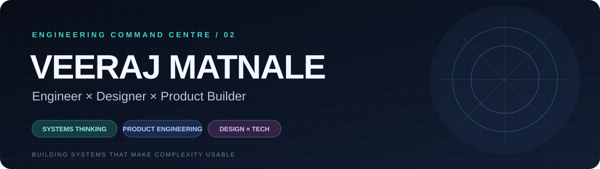

**I design and build systems at the intersection of engineering, product and visual thinking.**

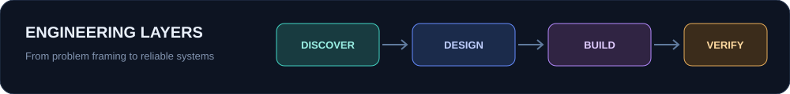

## COMMAND DECK

<table>
<tr>
<td width="33%" align="center"> <b>Architecture</b> Multi-tenant SaaS · APIs · Data flows</td>
<td width="33%" align="center"> <b>Implementation</b> Backend · Full-stack · Automation</td>
<td width="33%" align="center"> <b>Product & Design</b> UX systems · Visual communication</td>
</tr>
</table>

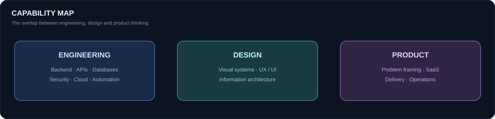

## SYSTEM DESIGN / THE CENTREPIECE

<table>
<tr><td width="50%">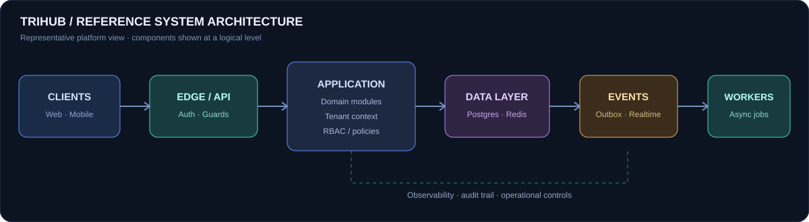</td><td width="50%">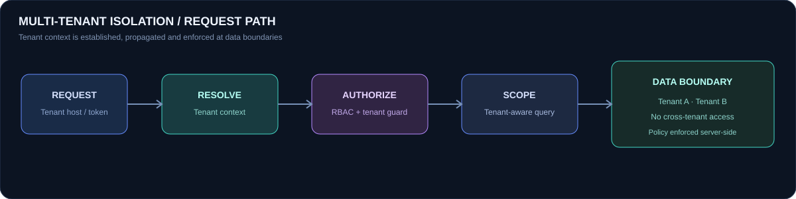</td></tr>
<tr><td width="50%">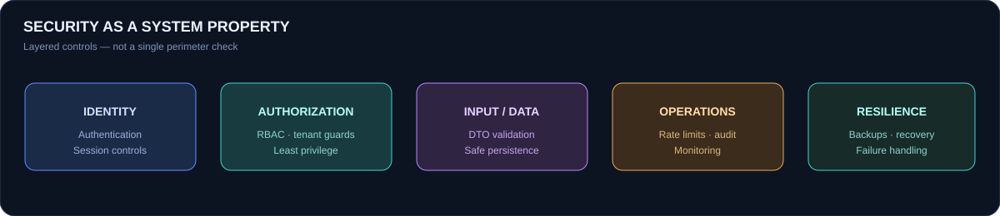</td><td width="50%">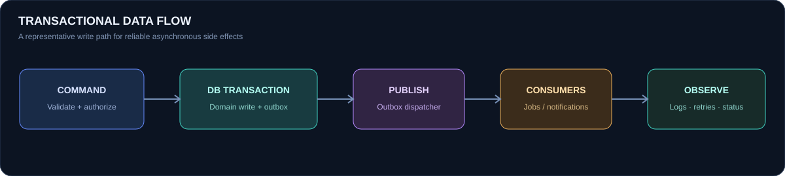</td></tr>
</table>

<b>Architecture notes — expand</b>

**TriHub ERP** is a multi-tenant higher-education SaaS platform. The working architecture spans a Next.js web portal, Flutter mobile app, NestJS services, PostgreSQL/Prisma persistence, Redis, real-time communication and asynchronous event processing.

- **Tenant boundary:** resolve tenant context, authorize access, and scope data operations server-side.
- **Application boundary:** domain modules, role-based access and explicit state transitions.
- **Data boundary:** relational persistence with cache and event-driven supporting services.
- **Reliability boundary:** transactional outbox pattern, retries, auditability and operational visibility.

These diagrams are logical reference views, not a claim that every deployment has identical topology.

## SELECTED BUILDS

<table>
<tr>
<td width="50%" valign="top">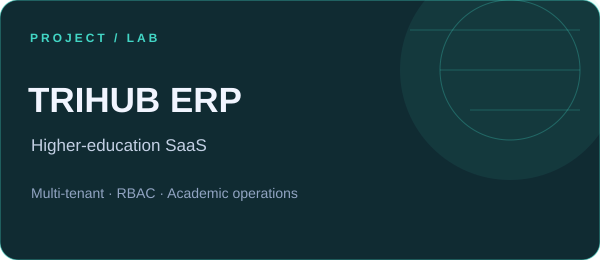<a href="https://github.com/Vrajm12/trihub"><b>TriHub ERP</b></a> Multi-tenant higher-education operating platform. Academic workflows, institutional operations, access control and quality systems.</td>
<td width="50%" valign="top">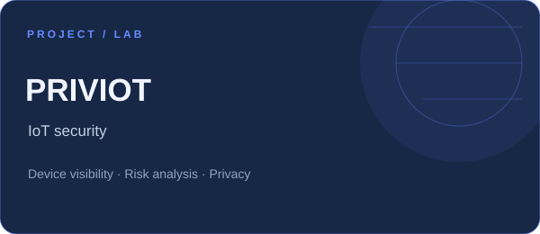<a href="https://github.com/Vrajm12/PrivIoT"><b>PrivIoT</b></a> IoT security analysis direction focused on device visibility, risk understanding and privacy-aware systems.</td>
</tr>
<tr>
<td width="50%" valign="top">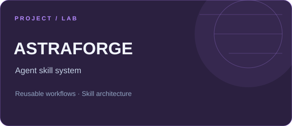<a href="https://github.com/Vrajm12/astraforge"><b>AstraForge</b></a> A modular skill system for structuring reusable agent workflows and repeatable engineering tasks.</td>
<td width="50%" valign="top">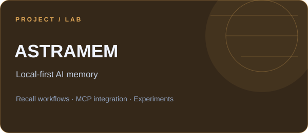<b>AstraMem</b> Experimental local-first AI memory and recall workflows, explored through MCP-oriented integration.</td>
</tr>
<tr>
<td width="50%" valign="top">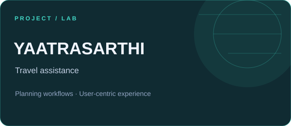<b>YaatraSarthi</b> Travel assistance concept built around planning workflows and user-centred experience.</td>
<td width="50%" valign="top">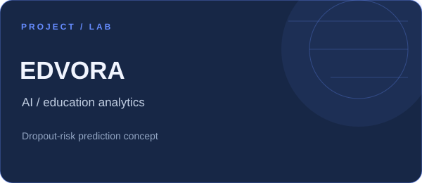<b>EdVora</b> AI-assisted education analytics concept exploring student dropout-risk prediction.</td>
</tr>
<tr>
<td width="50%" valign="top">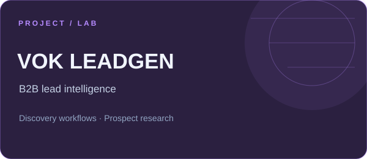<b>VOK LeadGen</b> B2B lead discovery and prospect research workflows for structured business development.</td>
<td width="50%" valign="top">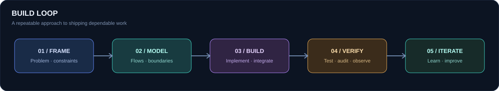</td>
</tr>
</table>

## TECHNOLOGY MATRIX

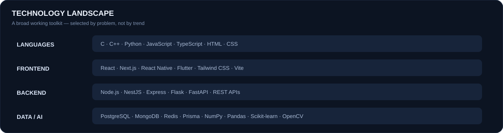

**Core stack**
 

**AI · automation · security**
 

## ENGINEERING LOOP

## GITHUB SIGNALS

<table>
<tr>
<td></td>
<td></td>
</tr>
</table>

 

---

**BUILD WITH INTENT. DESIGN FOR PEOPLE. ENGINEER FOR REALITY.**

Open to thoughtful collaborations across software, systems, product engineering and design.
  

