

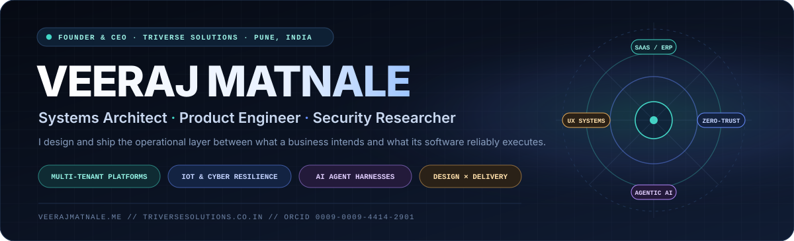

 

 

**Director, Founder & CEO at [Triverse Solutions Private Limited](https://triversesolutions.co.in) (Pune & Maval, India).**  
Architecting multi-tenant SaaS platforms, autonomous security tooling, and agentic engineering workflows that turn complex operational logic into dependable software.

 

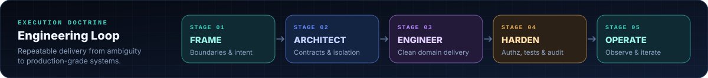

---

## FLAGSHIP BUILDS & RESEARCH

<table>
<tr>
<td width="50%" valign="top">
  <a href="https://veerajmatnale.me/work/trihub">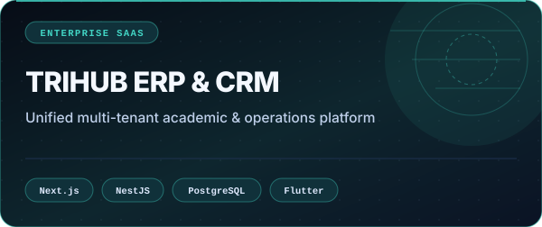</a>
   
  <b><a href="https://github.com/Vrajm12/trihub">TriHub ERP &amp; CRM</a></b> · <a href="https://veerajmatnale.me/work/trihub">Architecture Case Study ↗</a>
   
  Multi-tenant unified CRM &amp; higher-education ERP sharing one identity, tenant-scoped data boundary, and granular RBAC model.
</td>
<td width="50%" valign="top">
  <a href="https://veerajmatnale.me/work/priviot">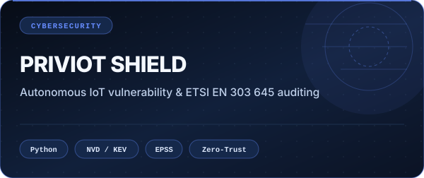</a>
   
  <b><a href="https://github.com/Vrajm12/PrivIoT">PrivIoT Shield</a></b> · <a href="https://veerajmatnale.me/work/priviot">Security Case Study ↗</a>
   
  Autonomous IoT security auditing integrating NVD, CISA KEV, EPSS exploit scoring, and ETSI EN 303 645 compliance checks.
</td>
</tr>
<tr>
<td width="50%" valign="top">
  
   
  <b><a href="https://github.com/Vrajm12/astraforge">AstraForge</a></b> · <a href="https://veerajmatnale.me/work/astraforge">System Case Study ↗</a>
   
  Open-source modular agent skill harness governing architecture framing, adversarial review, and evidence-backed execution.
</td>
<td width="50%" valign="top">
  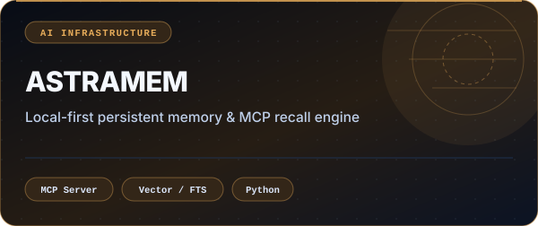
   
  <b>AstraMem</b> · Local-First MCP Infrastructure
   
  Persistent project memory and cross-session recall engine engineered around Model Context Protocol (MCP) workflows.
</td>
</tr>
<tr>
<td width="50%" valign="top">
  <a href="https://doi.org/10.20944/preprints202602.0398.v1">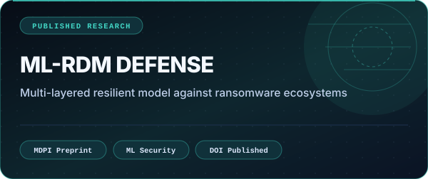</a>
   
  <b><a href="https://veerajmatnale.me/research">ML-RDM Defense</a></b> · <a href="https://doi.org/10.20944/preprints202602.0398.v1">MDPI Preprint DOI ↗</a>
   
  Published research modeling multi-layered resilient detection, containment, and recovery against evolving ransomware ecosystems.
</td>
<td width="50%" valign="top">
  
   
  <b>VOK LeadGen</b> · <a href="https://veerajmatnale.me/work/lead-qualification-engine">Workflow Case Study ↗</a>
   
  Structured B2B lead discovery, enrichment, and qualification pipeline built for repeatable outbound engineering.
</td>
</tr>
<tr>
<td width="50%" valign="top">
  
   
  <b>EdVora Analytics</b> · Applied Education ML
   
  Predictive analytics system identifying early student dropout risk to power timely academic intervention.
</td>
<td width="50%" valign="top">
  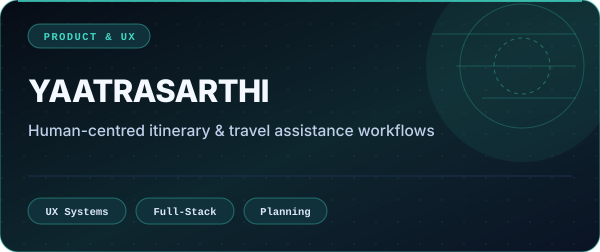
   
  <b>YaatraSarthi</b> · Product &amp; UX Systems
   
  User-centred travel assistance and itinerary orchestration designed around low-friction decision flows.
</td>
</tr>
</table>

---

## SYSTEM ARCHITECTURE BLUEPRINTS

<table>
<tr>
<td width="50%"></td>
<td width="50%">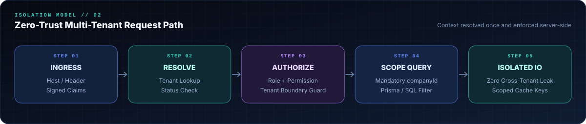</td>
</tr>
<tr>
<td width="50%"></td>
<td width="50%">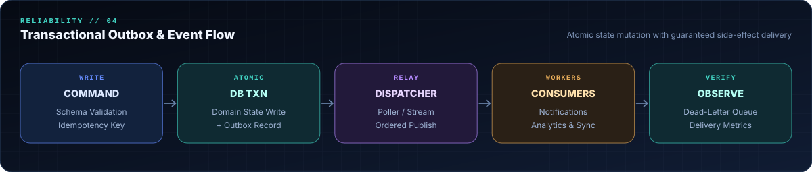</td>
</tr>
</table>

<b>Architectural invariants &amp; engineering notes — expand</b>

 

- **Tenant Isolation:** Tenant context is resolved at ingress, verified against role policies, and enforced through mandatory server-side data scoping—never trusted from client payloads.
- **Domain Modularity:** Services separate transport validation, domain state transitions, and persistence contracts so complex ERP/CRM rules stay testable.
- **Transactional Reliability:** Asynchronous side effects (notifications, audit logs, downstream sync) pair atomic relational writes with outbox dispatch and idempotent consumers.
- **Defense in Depth:** Authentication, least-privilege RBAC, strict DTO validation, rate limiting, and structured auditability operate as layered controls rather than a single perimeter check.

---

## RESEARCH, TECHNICAL WRITING & VENTURE

<table>
<tr>
<td width="50%" valign="top">

### Technical Writing & Research
- **Preprint (MDPI Preprints.org):** [ML-RDM: A Multi-Layered Resilient Defense Model Against Evolving Ransomware Ecosystems](https://veerajmatnale.me/research) · [DOI](https://doi.org/10.20944/preprints202602.0398.v1) · [ORCID](https://orcid.org/0009-0009-4414-2901)
- [Building TriHub's Multi-Tenant CRM & ERP Architecture](https://veerajmatnale.me/writing/building-trihub-multi-tenant)
- [How I Built PrivIoT Shield for Autonomous IoT Auditing](https://veerajmatnale.me/writing/how-i-built-priviot-shield)
- [Zero-Trust RBAC Patterns in Production SaaS](https://veerajmatnale.me/writing/zero-trust-rbac-patterns)
- [Custom ERP & CRM Systems Architecture](https://veerajmatnale.me/writing/pune-custom-software-erp-architecture) · [All Essays ↗](https://veerajmatnale.me/writing)

</td>
<td width="50%" valign="top">

### Triverse Solutions Private Limited
- **Role:** Director, Founder & CEO — [triversesolutions.co.in](https://triversesolutions.co.in)
- **Focus:** Custom enterprise software, multi-tenant ERP/CRM platforms, workflow automation, and product engineering for growing organizations.
- **Engineering Presence:** [Pune](https://triversesolutions.co.in/pune) · [Pimpri-Chinchwad](https://triversesolutions.co.in/pimpri-chinchwad) · [Talegaon Dabhade](https://triversesolutions.co.in/talegaon-dabhade) · [Kamshet / Maval](https://triversesolutions.co.in/kamshet)
- **Portfolio & Case Studies:** [veerajmatnale.me](https://veerajmatnale.me)

</td>
</tr>
</table>

---

## TECHNOLOGY MATRIX

 

---

## LIVE GITHUB TELEMETRY

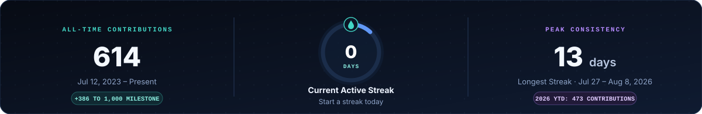

<table>
<tr>
<td width="50%">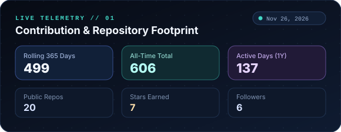</td>
<td width="50%">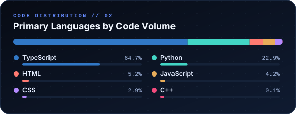</td>
</tr>
</table>

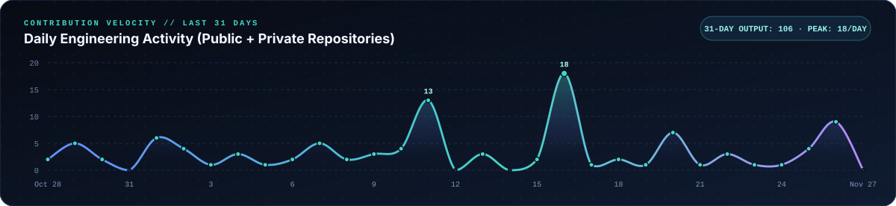

---

**BUILD WITH INTENT. DESIGN FOR PEOPLE. ENGINEER FOR REALITY.**  
Open to high-trust engineering, systems architecture, security research, and product collaborations.

 

