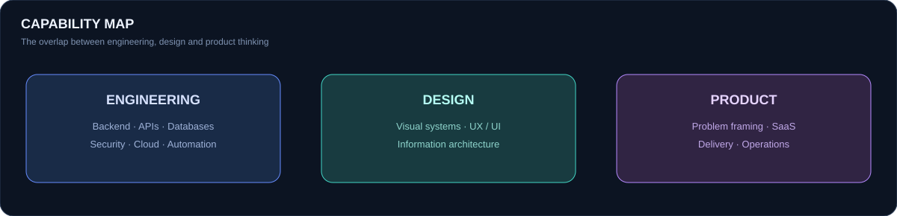
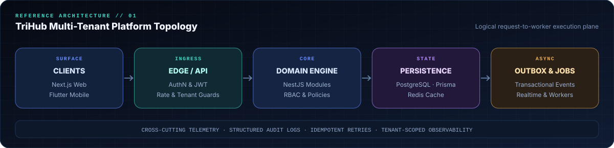
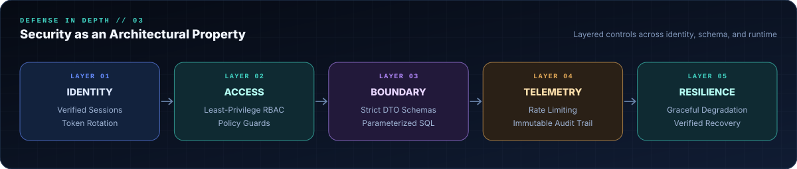
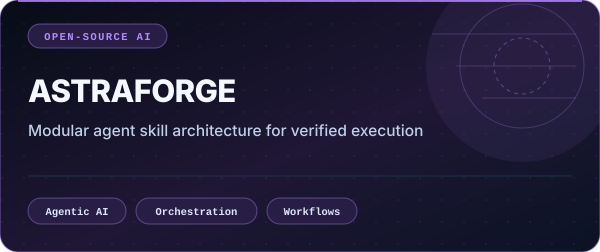
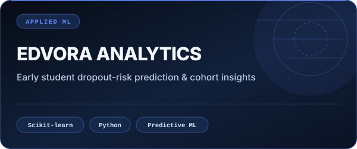
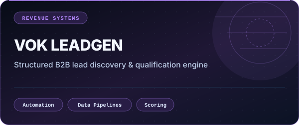
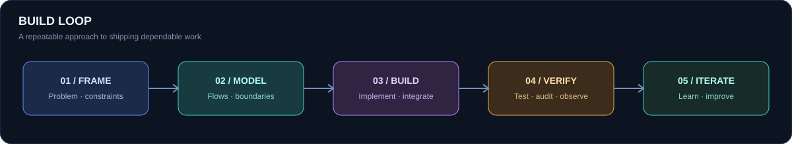
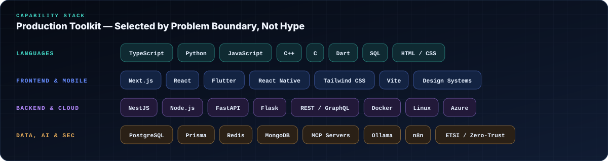

**Director, Founder & CEO at [Triverse Solutions Private Limited](https://triversesolutions.co.in) (Pune & Maval, India). I build the layer between what a business intends and what its software actually does.**

## COMMAND DECK

<table>
<tr>
<td width="33%" align="center"> <b>Architecture</b> Multi-tenant SaaS · APIs · Data flows</td>
<td width="33%" align="center"> <b>Implementation</b> Backend · Full-stack · Automation</td>
<td width="33%" align="center"> <b>Product & Design</b> UX systems · Visual communication</td>
</tr>
</table>

## SYSTEM DESIGN / THE CENTREPIECE

<table>
<tr><td width="50%"></td><td width="50%"></td></tr>
<tr><td width="50%"></td><td width="50%"></td></tr>
</table>

<b>Architecture notes — expand</b>

**TriHub ERP** is a multi-tenant higher-education SaaS platform. The working architecture spans a Next.js web portal, Flutter mobile app, NestJS services, PostgreSQL/Prisma persistence, Redis, real-time communication and asynchronous event processing.

- **Tenant boundary:** resolve tenant context, authorize access, and scope data operations server-side.
- **Application boundary:** domain modules, role-based access and explicit state transitions.
- **Data boundary:** relational persistence with cache and event-driven supporting services.
- **Reliability boundary:** transactional outbox pattern, retries, auditability and operational visibility.

These diagrams are logical reference views, not a claim that every deployment has identical topology.

## SELECTED BUILDS

<table>
<tr>
<td width="50%" valign="top"><a href="https://github.com/Vrajm12/trihub"><b>TriHub ERP</b></a> · <a href="https://veerajmatnale.me/work/trihub">Case Study</a> Multi-tenant unified CRM &amp; ERP platform sharing one account, data, and permission model.</td>
<td width="50%" valign="top"><a href="https://github.com/Vrajm12/PrivIoT"><b>PrivIoT Shield</b></a> · <a href="https://veerajmatnale.me/work/priviot">Case Study</a> Autonomous IoT security, NVD/CISA KEV/EPSS intelligence, and ETSI EN 303 645 compliance auditing.</td>
</tr>
<tr>
<td width="50%" valign="top"><a href="https://github.com/Vrajm12/astraforge"><b>AstraForge</b></a> · <a href="https://veerajmatnale.me/work/astraforge">Case Study</a> Open-source modular skill system for structuring reusable agent workflows, architecture, and verified execution.</td>
<td width="50%" valign="top"><b>AstraMem</b> Experimental local-first AI memory and recall workflows, explored through MCP-oriented integration.</td>
</tr>
<tr>
<td width="50%" valign="top"><b>YaatraSarthi</b> Travel assistance concept built around planning workflows and user-centred experience.</td>
<td width="50%" valign="top"><b>EdVora</b> AI-assisted education analytics concept exploring student dropout-risk prediction.</td>
</tr>
<tr>
<td width="50%" valign="top"><b>VOK LeadGen</b> · <a href="https://veerajmatnale.me/work/lead-qualification-engine">Case Study</a> B2B lead discovery and qualification workflows for structured business development.</td>
<td width="50%" valign="top"></td>
</tr>
</table>

## WRITING, RESEARCH & COMPANY

- **Portfolio & Architecture Notes:** [veerajmatnale.me](https://veerajmatnale.me) · [Technical Writing](https://veerajmatnale.me/writing)
- **Research Preprint (MDPI Preprints.org):** [ML-RDM: A Multi-Layered Resilient Defense Model Against Evolving Ransomware Ecosystems](https://veerajmatnale.me/research) ([DOI 10.20944/preprints202602.0398.v1](https://doi.org/10.20944/preprints202602.0398.v1)) · ORCID [0009-0009-4414-2901](https://orcid.org/0009-0009-4414-2901)
- **Selected Articles:** [Building Trihub Multi-Tenant CRM/ERP](https://veerajmatnale.me/writing/building-trihub-multi-tenant) · [PrivIoT Shield Architecture](https://veerajmatnale.me/writing/how-i-built-priviot-shield) · [Zero-Trust RBAC Patterns](https://veerajmatnale.me/writing/zero-trust-rbac-patterns) · [Custom ERP & CRM Systems in Pune](https://veerajmatnale.me/writing/pune-custom-software-erp-architecture)
- **Company:** [Triverse Solutions Private Limited](https://triversesolutions.co.in) — Custom [Software & ERP in Pune](https://triversesolutions.co.in/pune), [Pimpri-Chinchwad](https://triversesolutions.co.in/pimpri-chinchwad), [Talegaon Dabhade](https://triversesolutions.co.in/talegaon-dabhade), and [Kamshet / Maval](https://triversesolutions.co.in/kamshet)

## TECHNOLOGY MATRIX

**Core stack**
 

**AI · automation · security**
 

## ENGINEERING LOOP

## GITHUB SIGNALS

<table>
<tr>
<td></td>
<td></td>
</tr>
</table>

 

---

**BUILD WITH INTENT. DESIGN FOR PEOPLE. ENGINEER FOR REALITY.**

Open to thoughtful collaborations across software, systems, product engineering and design.
  

